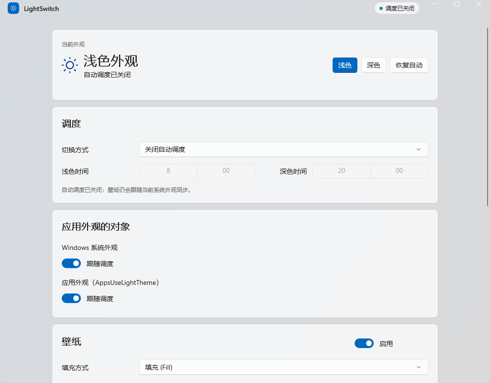
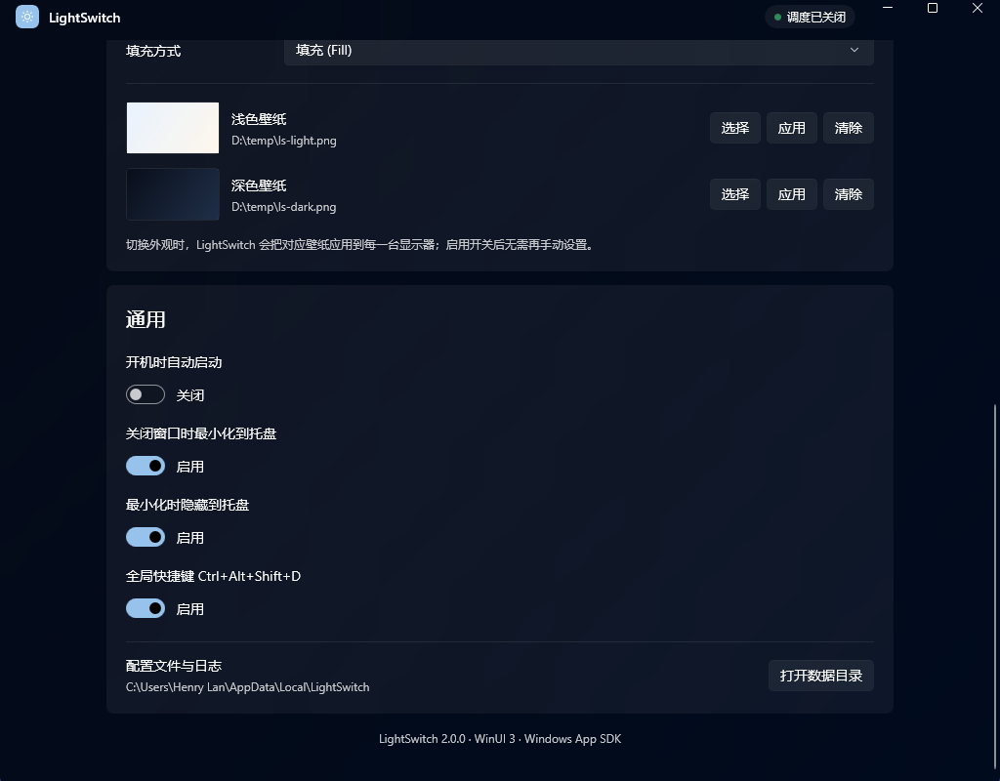

# LightSwitch for Windows

[简体中文](README.md) | **English**

> A lightweight, zero-runtime-dependency theme and wallpaper scheduler for Windows.

LightSwitch automatically switches the Windows **system theme, app theme, and desktop wallpaper** based on fixed hours, sunrise/sunset, or Night Light. v2 is rewritten in **C# + WinUI 3 + Windows App SDK + Fluent Design**, while keeping tray residency, a global hotkey, single-instance behavior, run-at-startup, and command-line control.

**v2.0.2: Windows installer and selected-appearance button feedback added; self-contained by default. The target PC needs neither .NET nor the Windows App Runtime.**

> In daily use it is a single ~92 MB tray process; the main window is created only when you open Settings.



*Main window in light mode (Windows 11, Mica backdrop)*

---

## Lightweight is a design constraint

LightSwitch does not treat “lightweight” as an adjective. It is a constraint applied to every design decision.

| Dimension | Measured / by design |
|-----------|----------------------|
| Tray residency | **91.9 MB** working set · **65.0 MB** private · **34** threads |
| Idle CPU | **0.016 s** of CPU time per 30 s (≈ 0%) |
| Processes | **1**: UI, tray, scheduler, and COM calls share one process |
| Services / drivers / scheduled tasks | **0** |
| Administrator rights | **Not required** |
| Network requests / telemetry | **0** |
| Visible windows at tray startup | **0** (only one hidden tray message window) |
| Default distribution | **170 MB / 461 files** (self-contained, includes .NET 10 and WinAppSDK) |

### Why not 2 MB?

v1 was written in C++ / Win32 with GDI drawing and could fit in under 2 MB. v2 uses WinUI 3, whose XAML runtime, compositor, and Windows App SDK impose a baseline of roughly 90 MB. That is a fixed cost of the UI stack, not business logic that became “heavy”.

The goal of v2 is not to pretend that cost does not exist, but to keep the **daily resident** cost at the low end of what a WinUI 3 app can achieve while preserving a Fluent interface:

- **No main window at tray startup**: XAML pages, cards, thumbnails, and the Mica composition tree are not loaded until Settings is opened.
- **No high-frequency polling**: the only routine periodic task is a scheduler evaluation every 30 seconds. Night Light uses a `RegNotifyChangeKeyValue` event; theme, time, and display changes trigger evaluation directly.
- **Wallpaper previews decode at 160 px**: `BitmapImage.DecodePixelWidth = 160`, so a 4K source is never fully decoded into UI memory.
- **Wallpapers are referenced in place**: no copy, transcode, or full-image cache.
- **One process, no service**: no Windows service, driver, scheduled task, or second helper process.
- **No network or telemetry**: the app makes no network requests; configuration and logs stay local.
- **Trimmed dependencies**: only `Microsoft.WindowsAppSDK.WinUI` and `Microsoft.WindowsAppSDK.Runtime`, not the full metapackage.
- **Bounded logs**: automatic rotation at 512 KB.

### 170 MB is disk, not RAM

The default self-contained build ships the .NET 10 runtime and Windows App SDK in the output folder, so it occupies **170 MB** on disk. The runtime does not load the whole folder into memory: tray residency is still about **92 MB**.

If the target PC already has the .NET 10 Desktop Runtime, `-FrameworkDependent` produces a **93 MB / 269-file** build with the same memory behavior.

### Honest limits

- After the main window has been opened once, WinUI keeps the window object and visual tree alive. Closing to the tray keeps the process resident, but memory does not automatically return to 92 MB. Destroying the last window would terminate the process; that is a current WinUI desktop limitation.
- The recommended daily setup is therefore: start silently with `--startup`, and open the window only when settings need to change.
- Exact numbers vary with GPU driver, DPI, Windows build, and wallpaper thumbnails. The table above contains Release measurements from one machine.

---

## Features

### Automatic switching

- **Fixed hours**: for example, light at 08:00 and dark at 20:00.
- **Sunrise/sunset**: enter latitude and longitude; switch on local astronomical times, with separate offsets for sunrise and sunset.
- **Follow Night Light**: dark while Windows Night Light is on, light while it is off.
- **Cross-midnight**: supports light periods such as 22:00–06:00.
- **Manual override with automatic recovery**: a manual switch pauses the schedule until the next light/dark boundary, then automation resumes. “Restore automatic” resumes immediately.
- **Independent system and app themes**: control only the taskbar/Start menu, or only app windows.

### Wallpaper pairing

- **Separate light and dark wallpapers**: choose one image for each theme and apply them automatically.
- **Applied to every monitor**: `IDesktopWallpaper` is called per monitor; displays are re-enumerated after hot-plug.
- **Six fit modes**: `Fill`, `Fit`, `Stretch`, `Center`, `Tile`, and `Span`.
- **Thumbnail previews**: decoded at 160 px so a 4K image is not loaded whole.
- **Apply now**: the button next to each wallpaper previews it immediately, even while the wallpaper master switch is off.
- **Path validation**: missing files never reach COM; the UI shows an error and the log records it.
- **End-to-end integration**: automatic scheduling, manual switches, the tray menu, the global hotkey, and `--apply light|dark` all switch theme and wallpaper together.



*Wallpaper settings: separate light/dark images, thumbnails, and immediate apply*

### Desktop experience

- **Tray residency**: closing or minimizing hides the window; the main window is created on demand.
- **Single instance**: a second launch brings the existing window forward; a second `--startup` launch does not pop up a window.
- **Global hotkey**: `Ctrl+Alt+Shift+D` switches light/dark (and wallpaper).
- **Run at startup**: an in-app toggle writes the current user's `Run` key and starts with `--startup`.
- **Command line**: `--toggle`, `--apply light|dark`, `--startup`, `--enable-startup` / `--disable-startup`, and more.
- **Installer**: per-user, no administrator rights; Chinese/English wizard, Start Menu and optional desktop shortcuts, standard uninstall entry.
- **Fluent UI**: card layout, Mica backdrop (Windows 11), custom title bar, light/dark resources.
- **No administrator rights**: writes only HKCU and the current user's desktop wallpaper; no service, no elevation.

---

## Requirements

| Item | Requirement |
|------|-------------|
| OS | Windows 10 1809+ / Windows 11, x64 |
| Runtime (default build) | **None**: .NET 10 and Windows App SDK are bundled |
| Graphics | A Windows desktop capable of WinUI 3 |
| Permissions | Standard user (HKCU + current user's wallpaper); the installer needs no admin |
| Disk | About 170 MB self-contained; about 93 MB framework-dependent |
| Installer (optional) | About 44 MB; per-user install, uninstall entry in Settings > Apps |

Notes:

- Mica is a Windows 11 feature. Windows 10 falls back to a solid background; everything else still works.
- If disk size matters more and the target PC has the .NET 10 Desktop Runtime, use `build.ps1 -Publish -FrameworkDependent`.
- The build machine needs the .NET 10 SDK. The self-contained bundler copies that machine's .NET 10 runtime into the publish folder; it does not download runtime packs from NuGet.
- The installer is not code-signed, so Windows SmartScreen may show "Windows protected your PC". Verify the SHA256 published with the release, or build from source yourself.

---

## Quick start

### Installer (recommended)

Download `LightSwitch-<version>-setup.exe` from [Releases](https://github.com/realhenrylan/LightSwitch-Windows/releases) and run it.

- **Per-user install, no administrator rights.** The default location is `%LOCALAPPDATA%\Programs\LightSwitch`; a Start Menu shortcut is created.
- The wizard supports Simplified Chinese and English, and offers an optional desktop shortcut.
- **Run at startup is enabled by default**, applied only on a fresh install; upgrades leave your existing choice alone, and it can be turned off later in Settings.
- To uninstall: Settings > Apps > LightSwitch, or the Start Menu uninstall entry. User settings, logs, and cache in `%LOCALAPPDATA%\LightSwitch` are kept by default; choose "Yes" in the uninstall wizard to remove them. A silent uninstall always keeps the data.
- Prefer no install? Download `LightSwitch-<version>-portable.zip`, extract it, and run `LightSwitch.exe`.
- Both the installer and the portable zip ship with a matching `.sha256`; verify it with `Get-FileHash` or `certutil -hashfile`.

For silent install and uninstall arguments, see [installer/README.md](installer/README.md).

### Build from source (optional)

Prerequisites:

- [.NET 10 SDK](https://dotnet.microsoft.com/download/dotnet/10.0) (10.0.4xx or newer)
- Windows 10/11 x64
- NuGet access on the first build (later builds use the local cache)
- [Inno Setup 6.5+](https://jrsoftware.org/isdl.php) only if you build the installer; skip it to build/run the app alone

```powershell
git clone https://github.com/realhenrylan/LightSwitch-Windows.git
cd LightSwitch-Windows

# Build Release
.\build.ps1

# Build and run 31 tests
.\build.ps1 -Test

# Publish a self-contained folder (no .NET install on the target)
.\build.ps1 -Publish

# Publish and build the installer (requires Inno Setup 6.5+)
.\build.ps1 -Publish -Installer

# Optional: smaller framework-dependent build (target needs .NET 10 Desktop Runtime)
.\build.ps1 -Publish -FrameworkDependent
```

`-Installer` implies `-Publish` and is mutually exclusive with `-FrameworkDependent` (the installer packages the self-contained folder). To recompile the installer against an existing publish folder, use `.\tools\build-installer.ps1 -SkipPublish`.

You can also run `build.bat`. Default build output:

```text
src\LightSwitch.App\bin\Release\net10.0-windows10.0.19041.0\win-x64\LightSwitch.exe
```

Default publish output:

```text
artifacts\LightSwitch-win-x64\LightSwitch.exe
```

Installer output:

```text
artifacts\LightSwitch-<version>-setup.exe
```

The build also writes `LightSwitch-<version>-setup.exe.sha256`. GitHub Releases additionally provide `LightSwitch-<version>-portable.zip` and its `.sha256`.

### Upgrading from v1.x

If you use the installer, just run the new `setup.exe` over the existing install. It stops the running LightSwitch first; settings and logs in `%LOCALAPPDATA%\LightSwitch` are preserved. Portable users can follow these steps:

1. Exit the old C++ LightSwitch.
2. Run the v2 `LightSwitch.exe`.
3. If `%LOCALAPPDATA%\LightSwitch\config.json` does not exist, v2 tries to import the old `config.json` next to the executable.
4. Open Settings and check wallpaper paths, run-at-startup, and the hotkey toggle.

The v1 source is archived under [`legacy/`](legacy/README.md) for reference only.

---

## Usage

### Main window

| Area | Description |
|------|-------------|
| Current appearance | Current system theme, schedule mode, next switch time; light, dark, and “restore automatic” mark the choice in effect with an accent color. A manual switch stays highlighted until the override ends or you click “restore automatic”; “restore automatic” is disabled when the schedule is off |
| Schedule | Off / fixed hours / sunrise-sunset / follow Night Light; 24-hour time |
| Sunrise/sunset | Latitude, longitude, sunrise offset, sunset offset; editable only in this mode |
| Theme targets | Control Windows system theme and app theme independently |
| Wallpaper | Master switch, fit mode, light/dark wallpapers; choose, apply, clear |
| General | Run at startup, close to tray, minimize to tray, global hotkey, data folder |
| About | Version and technology stack |

Changes save to `config.json` immediately on focus loss or selection; there is no Save button.

### Wallpaper setup

1. Open the Wallpaper card and enable the switch in its header.
2. Click Choose on the light wallpaper row and select an image.
3. Click Choose on the dark wallpaper row and select an image.
4. Select a fit mode (default: `Fill`).
5. Click Apply on either row to preview immediately instead of waiting for the next schedule evaluation.

Use images close to your monitor aspect ratio; `Span` works well for a multi-monitor panorama.

### Tray menu

Right-click the tray icon:

| Item | Action |
|------|--------|
| Show main window | Open settings |
| Switch to light / dark | Apply theme and wallpaper immediately |
| Enable / disable schedule | Toggle between Off and Fixed hours |
| Exit | Terminate the process |

Double-clicking or left-clicking the icon also shows the main window. Windows 11 puts new icons in the overflow area by default; pin LightSwitch via Settings → Personalization → Taskbar → Other system tray icons.

### Global hotkey

| Hotkey | Action |
|--------|--------|
| `Ctrl+Alt+Shift+D` | Switch light/dark (and wallpaper) |

The hotkey can be disabled in Settings. If it is already registered, the log records `RegisterHotKey failed`; the tray and UI keep working.

### Closing and minimizing

- “Close window to tray” is on by default: the close button hides the window and keeps the process running.
- “Minimize to tray” is on by default: minimizing removes the taskbar entry.
- With both off, closing the window exits the app.
- To exit, use the tray menu or turn both options off and close the window.

---

## Command line

```powershell
LightSwitch.exe                    # Show the main window (with tray)
LightSwitch.exe --startup          # Start silently in the tray (used by run-at-startup)
LightSwitch.exe --hidden           # Same as --startup
LightSwitch.exe --tray             # Same as --startup
LightSwitch.exe --toggle           # Switch theme + wallpaper once, then exit
LightSwitch.exe --apply light      # Apply light theme + light wallpaper, then exit
LightSwitch.exe --apply dark       # Apply dark theme + dark wallpaper, then exit
LightSwitch.exe --enable-startup   # Enable run-at-startup, then exit
LightSwitch.exe --disable-startup  # Disable run-at-startup, then exit
```

- `/toggle`, `/light`, `/dark`, `/enable-startup`, and `/disable-startup` are also supported.
- One-shot commands do not initialize WinUI. If an instance is already running, theme commands are forwarded through its hidden window.
- `--enable-startup` / `--disable-startup` update both `runAtStartup` in `config.json` and the HKCU `Run` entry, exiting with code 1 on failure. Because they change on-disk configuration and the registry, they are always executed directly by the new process and never forwarded to the tray instance; the installer calls `--enable-startup` on a fresh install.
- `--startup` / `--hidden` / `--tray` do not pop up an existing window.

---

## Configuration

Path:

```text
%LOCALAPPDATA%\LightSwitch\config.json
```

The file is created when settings change. You can also copy [`config.example.json`](config.example.json) and edit it. On first run, if the new path does not exist, v2 tries to import the old `config.json` next to the executable.

```json
{
  "scheduleMode": "FixedHours",
  "changeSystem": true,
  "changeApps": true,
  "lightTime": 480,
  "darkTime": 1200,
  "latitude": "39.9",
  "longitude": "116.4",
  "sunrise_offset": 0,
  "sunset_offset": 0,
  "changeWallpaper": true,
  "lightWallpaper": "C:/Wallpapers/light.jpg",
  "darkWallpaper": "C:/Wallpapers/dark.jpg",
  "wallpaperPosition": "Fill",
  "runAtStartup": false,
  "minimizeToTray": true,
  "closeToTray": true,
  "hotkeyEnabled": true
}
```

| Field | Type | Default | Description |
|-------|------|---------|-------------|
| `scheduleMode` | string | `"Off"` | `Off` / `FixedHours` / `SunsetToSunrise` / `FollowNightLight` |
| `changeSystem` | bool | `true` | Control the Windows system theme |
| `changeApps` | bool | `true` | Control the app theme |
| `lightTime` | int | `480` | Light start time in minutes from midnight (480 = 08:00) |
| `darkTime` | int | `1200` | Dark start time in minutes from midnight (1200 = 20:00) |
| `latitude` | string | `"39.9"` | Latitude in decimal degrees |
| `longitude` | string | `"116.4"` | Longitude in decimal degrees |
| `sunrise_offset` | int | `0` | Sunrise offset in minutes, -720 to 720 |
| `sunset_offset` | int | `0` | Sunset offset in minutes, -720 to 720 |
| `changeWallpaper` | bool | `false` | Switch wallpaper with the theme |
| `lightWallpaper` | string | `""` | Absolute path to the light wallpaper |
| `darkWallpaper` | string | `""` | Absolute path to the dark wallpaper |
| `wallpaperPosition` | string | `"Fill"` | `Fill` / `Fit` / `Stretch` / `Center` / `Tile` / `Span` |
| `runAtStartup` | bool | `false` | Write the HKCU Run entry |
| `minimizeToTray` | bool | `true` | Hide to tray when minimized |
| `closeToTray` | bool | `true` | Hide to tray when closed |
| `hotkeyEnabled` | bool | `true` | Register `Ctrl+Alt+Shift+D` |

Notes:

- `sunrise_offset` / `sunset_offset` keep the v1 field names for migration; all other fields are camelCase.
- `lightTime` / `darkTime` are shown as `HH:mm` in the UI and stored as minutes.
- Editing `config.json` externally requires an app restart in the current version.
- Wallpaper paths should be absolute. A missing file is reported in the log and UI; the existing wallpaper is left untouched.

---

## Performance

Test machine: Windows 11 (10.0.26300), Intel i5-14490F (10 cores / 16 threads), x64, Release build. Memory is the stable value after 30 seconds; CPU is process CPU time over a 30-second interval.

| Scenario | Working set | Private | Threads | Notes |
|----------|-------------|---------|---------|-------|
| Silent tray startup (`--startup`, window never opened) | **91.9 MB** | **65.0 MB** | 34 | 0.016 s CPU time over 30 s |
| Main window open | **148–149 MB** | ~100 MB | 67–68 | Cards, Mica, and thumbnails loaded |
| Framework-dependent publish | — | — | — | 93 MB / 269 files |
| Self-contained publish | — | — | — | 170 MB / 461 files |

**Reading the numbers**

- Tray mode is the recommended daily shape: start silently at login, open the window only when needed.
- After the window has been opened and then closed to the tray, WinUI keeps the window object alive; memory usually stays around 146–149 MB. This is a known boundary of the current implementation, not an instant return to 92 MB.
- GPU driver, DPI, Windows build, and wallpaper thumbnails all affect the result. Measure a Release build on the target machine when exact numbers matter.

---

## Architecture

### Project layout

```text
LightSwitch-Windows/
├── LightSwitch.slnx              # Solution (.NET 10 slnx)
├── Directory.Build.props         # Shared version/language properties
├── NuGet.config                  # nuget.org source
├── build.ps1 / build.bat         # Build, test, publish
├── .github/
│   └── workflows/release.yml     # Tag-driven release automation
├── installer/
│   ├── LightSwitch.iss           # Inno Setup script
│   ├── ChineseSimplified.isl     # Simplified Chinese wizard language file
│   └── README.md                 # Installer build and silent-install notes
├── tools/
│   ├── build-installer.ps1       # Compile the installer and write SHA256
│   └── bundle-dotnet-runtime.ps1 # Copy the .NET runtime into the publish folder
├── config.example.json           # Example configuration
├── README.md / README.en.md      # Chinese / English
├── CHANGELOG.md / PLAN.md
├── LICENSE
├── docs/screenshots/
├── src/
│   ├── LightSwitch.Core/         # Pure logic, no WinUI dependency
│   │   ├── AppSettings.cs        # Config model, Clone, Normalize, coordinate validation
│   │   ├── SettingsService.cs    # Load/save, legacy import, atomic write, corrupt backup
│   │   ├── AppearanceEngine.cs   # Scheduling state machine, manual override, snapshots
│   │   ├── ThemeService.cs       # HKCU Personalize registry + broadcasts
│   │   ├── WallpaperService.cs   # IDesktopWallpaper COM + SPI fallback
│   │   ├── NightLightService.cs  # Read CloudStore Night Light state
│   │   ├── NightLightWatcher.cs  # RegNotifyChangeKeyValue watcher thread
│   │   ├── ScheduleMath.cs       # Cross-midnight checks, next boundary
│   │   ├── SunCalculator.cs      # Sunrise/sunset astronomy
│   │   ├── StartupService.cs     # HKCU Run entry
│   │   └── AppPaths / Log / Models / EngineState / Interfaces
│   └── LightSwitch.App/          # WinUI 3 app
│       ├── Program.cs            # Custom Main, single instance, CLI dispatch
│       ├── App.xaml(.cs)         # XAML resources and startup
│       ├── AppHost.cs            # Lifetime, tray, timer, settings persistence
│       ├── MainWindow.xaml(.cs)  # Fluent settings UI
│       ├── CommandLine.cs / CliRunner.cs
│       ├── Tray/TrayHost.cs      # Hidden Win32 window + Shell_NotifyIcon
│       ├── Tray/IconFactory.cs
│       ├── Interop/NativeMethods.cs
│       └── Assets/app.ico
├── tests/
│   └── LightSwitch.Tests/        # Zero-dependency console harness (31 cases)
└── legacy/                       # v1.1.0 C++ / Win32 + GDI archive
```

### Runtime flow

```text
Timer (30 s) / system events / Night Light changes / manual UI / tray / hotkey / CLI
                              │
                              ▼
                    AppearanceEngine.Evaluate
                              │
              ┌───────────────┼────────────────┐
              ▼               ▼                ▼
        ThemeService     WallpaperService  State snapshot / StateChanged
        (registry +      (COM, per monitor)        │
         broadcasts)                              ▼
                                          MainWindow / TrayHost
```

- **Theme**: write `SystemUsesLightTheme` and `AppsUseLightTheme` under `HKCU\Software\Microsoft\Windows\CurrentVersion\Themes\Personalize`, then broadcast `WM_SETTINGCHANGE("ImmersiveColorSet")`, `WM_THEMECHANGED`, and `WM_DWMCOLORIZATIONCOLORCHANGED`.
- **Wallpaper**: `CoCreateInstance(CLSID_DesktopWallpaper)` → `IDesktopWallpaper.SetPosition` plus `SetWallpaper` per monitor. If COM is unavailable, fall back to `SystemParametersInfo(SPI_SETDESKWALLPAPER)` and the `WallpaperStyle` registry values.
- **Night Light**: read the binary `Data` under `HKCU\...\CloudStore\...\bluelightreductionstate`; length ≥ 25 with `data[23] == 0x10 && data[24] == 0x00` means enabled. A background thread watches it with `RegNotifyChangeKeyValue`.
- **Manual override**: in FixedHours / SunsetToSunrise, a manual switch records `manualUntil = next light/dark boundary` and automation resumes after it. `Off` and `FollowNightLight` do not record an override.
- **Single instance**: `Local\LightSwitch.SingleInstance` mutex; an existing instance is notified with `FindWindowW("LightSwitch.TrayHost")` + `PostMessage` of a `WM_APP` message.
- **Tray**: a hidden top-level window receives `Shell_NotifyIcon` callbacks; the context menu uses native `TrackPopupMenuEx`; the hotkey uses `RegisterHotKey` with `MOD_NOREPEAT`.

### Schedule semantics

| Mode | Target | Notes |
|------|--------|-------|
| `Off` | Does not write a theme | Still syncs wallpaper to the current system theme when wallpaper is enabled |
| `FixedHours` | `lightTime` / `darkTime` | Cross-midnight supported; manual override until the next boundary |
| `SunsetToSunrise` | Astronomical sunrise/sunset from coordinates | Recalculated daily; polar day/night falls back to 06:00 / 18:00 |
| `FollowNightLight` | Night Light on = dark, off = light | Watches the registry; no manual override |

---

## Wallpaper implementation

v2's wallpaper behavior is inspired by the public design of [AutoDarkMode / Windows-Auto-Night-Mode](https://github.com/AutoDarkMode/Windows-Auto-Night-Mode), but implements only a **simplified subset**:

| Capability | LightSwitch v2 | AutoDarkMode |
|------------|----------------|--------------|
| One light + one dark wallpaper | ✅ | ✅ |
| Apply to all monitors | ✅ loops `SetWallpaper` | ✅ global and per-monitor |
| Per-monitor images | ❌ | ✅ |
| Fit modes | ✅ six | ✅ |
| Solid color / Spotlight | ❌ | ✅ |
| Thumbnail preview | ✅ 160 px decode | ✅ |
| Integrated with schedule/manual switch | ✅ | ✅ |

Implementation notes:

- Uses `IDesktopWallpaper` (IID `{B92B56A9-8B55-4E14-9A89-0199BBB6F93B}`, CLSID `{C2CF3110-460E-4fc1-B9D0-8A1C0C9CC4BD}`).
- Calls `SetWallpaper(monitorId, path)` once per monitor; `SetPosition` is global.
- `HKCU\Control Panel\Desktop\WallPaper` cannot be used to detect the current wallpaper (Windows rewrites it to `TranscodedWallpaper`); state comparison uses `GetWallpaper(monitorId)`.
- Wallpapers are referenced by their original path; files are not copied. If an image is moved or deleted, the next switch fails and logs the reason.

---

## Known limitations

- **One global wallpaper pair**: different images per monitor are not supported.
- **No solid color / Windows Spotlight / slideshow history**.
- **No hot reload of `config.json`**: restart the app or change a setting in the UI.
- **Mica is Windows 11 only**: Windows 10 uses a solid background.
- **Memory baseline**: about 92 MB in silent tray mode; about 146–149 MB after the main window has been opened. Hiding the window does not release its visual tree.
- **Fixed hotkey**: `Ctrl+Alt+Shift+D`; custom combinations are not supported yet.
- **Self-contained builds are assembled from the build machine's .NET runtime**: the build machine needs the matching .NET 10 SDK, and the publish folder contains a copy of that runtime.
- **The UI is Simplified Chinese only**: the English README is documentation, not a UI localization.
- **Single user session**: the mutex lives under `Local\`; separate login sessions can each run an instance.

---

## Troubleshooting

### Logs

```text
%LOCALAPPDATA%\LightSwitch\LightSwitch.log
```

The log rotates to `LightSwitch.log.old` at 512 KB. It records startup arguments, every evaluation, theme/wallpaper results, tray/hotkey registration failures, and configuration save errors.

### Tray icon is missing

Windows 11 puts new icons in the overflow area. Open Settings → Personalization → Taskbar → Other system tray icons and set LightSwitch to visible. If it is still missing, check the log for `Shell_NotifyIcon(NIM_ADD) failed`.

### Wallpaper does not change

1. Confirm the Wallpaper master switch is enabled.
2. Confirm both light and dark wallpapers are selected and still exist.
3. Check the schedule mode: `Off` does not change the theme but still syncs wallpaper to the current theme; `FollowNightLight` requires a Night Light state change.
4. Click Apply on the relevant wallpaper row to force one application and watch for `Wallpaper applied ...` or an error in the log.
5. If the log says the wallpaper was set but the desktop did not change, group policy or third-party wallpaper software may be taking over the desktop.

### Run at startup does not work

- Enabling “Run at startup” writes `HKCU\Software\Microsoft\Windows\CurrentVersion\Run` with `"<current exe path>" --startup`.
- The installer pre-checks run-at-startup on a fresh install; an in-place upgrade leaves your existing choice alone.
- You can also run `LightSwitch.exe --enable-startup` or `--disable-startup` to update both `config.json` and the registry; failure exits with code 1.
- After moving the executable, toggle the option off and on to refresh the path.
- Some security products block Run-key writes; check the log for `startup` errors.

### Hotkey does not work

`RegisterHotKey failed` in the log means the combination is already registered. Disable the hotkey in Settings, exit the conflicting app, then enable it again.

### Reset settings

Delete `%LOCALAPPDATA%\LightSwitch\config.json` and restart the app to return to defaults (schedule off, wallpaper off). You can also open the data folder from Settings and delete it there.

---

## Development

### Build and test

```powershell
dotnet build LightSwitch.slnx -c Release
.\build.ps1 -Test
```

Tests use a zero-dependency console harness (`tests/LightSwitch.Tests`) with no xUnit package. Coverage includes:

- `ScheduleMath`: same-day and cross-midnight boundaries, next boundary, exact-boundary rollover;
- `SunCalculator`: Beijing, equator, polar day, invalid coordinates;
- `SettingsService`: legacy snake_case config, round-trip serialization, Normalize;
- `AppearanceEngine`: fixed hours, manual override to the next boundary, FollowNightLight, light/dark wallpaper, Off mode, sunset offsets, and keeping the manual choice when the theme targets are disabled.

Current result: **31/31 passing**.

### Publish

```powershell
# Default: self-contained; the target needs no .NET runtime
.\build.ps1 -Publish

# Optional: framework-dependent, smaller, target needs .NET 10 Desktop Runtime
.\build.ps1 -Publish -FrameworkDependent
```

Output goes to `artifacts\LightSwitch-win-x64\` (override with `-OutputDirectory`).

Build the installer:

```powershell
# Publish + installer (requires Inno Setup 6.5+; ISCC.exe on PATH or in the default install folder)
.\build.ps1 -Publish -Installer
```

- The installer is written to `artifacts\LightSwitch-<version>-setup.exe` with a matching `.sha256`.
- `-Installer` implies `-Publish` and is mutually exclusive with `-FrameworkDependent`. `tools\build-installer.ps1` can be called directly: `-SkipPublish` reuses an existing publish folder, `-IsccPath` selects ISCC.exe, and `-Version` overrides the version.
- Pushing a `v*` tag or manually dispatching `.github/workflows/release.yml` strips the `v` prefix from the tag name (or the manual `version` input) and fails unless it equals `<Version>` in `Directory.Build.props`. The workflow then builds and tests, produces the installer and portable zip with their SHA256 files, and finally creates or updates the GitHub Release.
- Release assets: `LightSwitch-<version>-setup.exe`, `LightSwitch-<version>-portable.zip`, and a `.sha256` for each.

The self-contained build first runs `dotnet publish` to produce a framework-dependent folder, then `tools/bundle-dotnet-runtime.ps1`:

1. copies every file from the build machine's `shared\Microsoft.NETCore.App\<version>`;
2. copies the matching `hostfxr.dll`;
3. rewrites `runtimeconfig.json` from `framework` to `includedFrameworks` and merges the runtime assets into `deps.json`.

This avoids downloading runtime packs from NuGet. The cost is a publish folder of about 170 MB / 461 files; rerun the build after updating the .NET runtime.

### Code conventions

- `LightSwitch.Core` never references WinUI. Registry, COM, and P/Invoke calls live in Core services so they remain testable.
- `AppSettings` is treated as immutable by the engine; the UI edits a `Clone()` and passes the whole object back.
- New scheduling logic belongs in `ScheduleMath` / `AppearanceEngine` with tests.
- P/Invoke constants live in `Interop/NativeMethods.cs`; avoid magic numbers in business code.

---

## License

This project is licensed under the [MIT License](LICENSE).

- v1 was based on the LightSwitch module in [Microsoft PowerToys](https://github.com/microsoft/PowerToys) (MIT); v2 keeps its approach to theme registry values, Night Light detection, and sunrise/sunset math.
- The wallpaper design references [AutoDarkMode / Windows-Auto-Night-Mode](https://github.com/AutoDarkMode/Windows-Auto-Night-Mode) (MIT).
- Windows, WinUI, and Windows App SDK are trademarks/products of Microsoft. This project is not affiliated with Microsoft.
