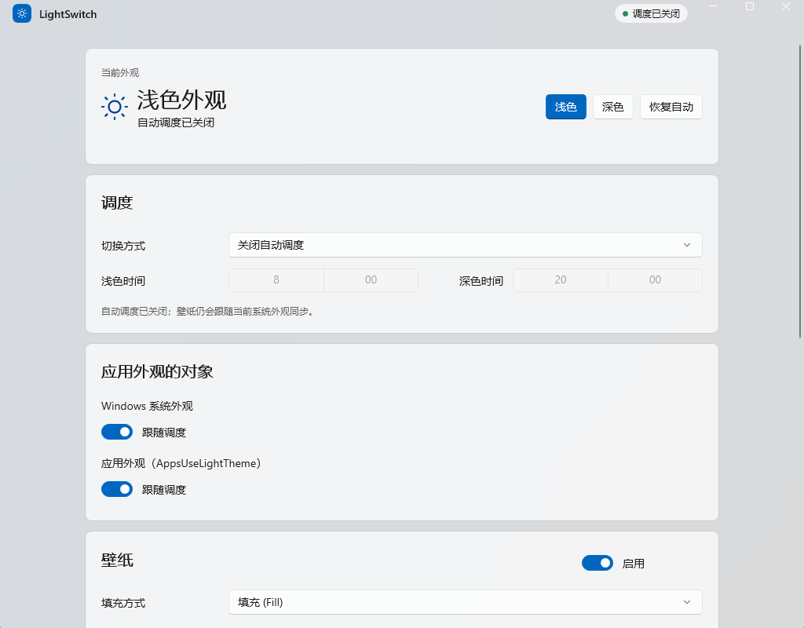
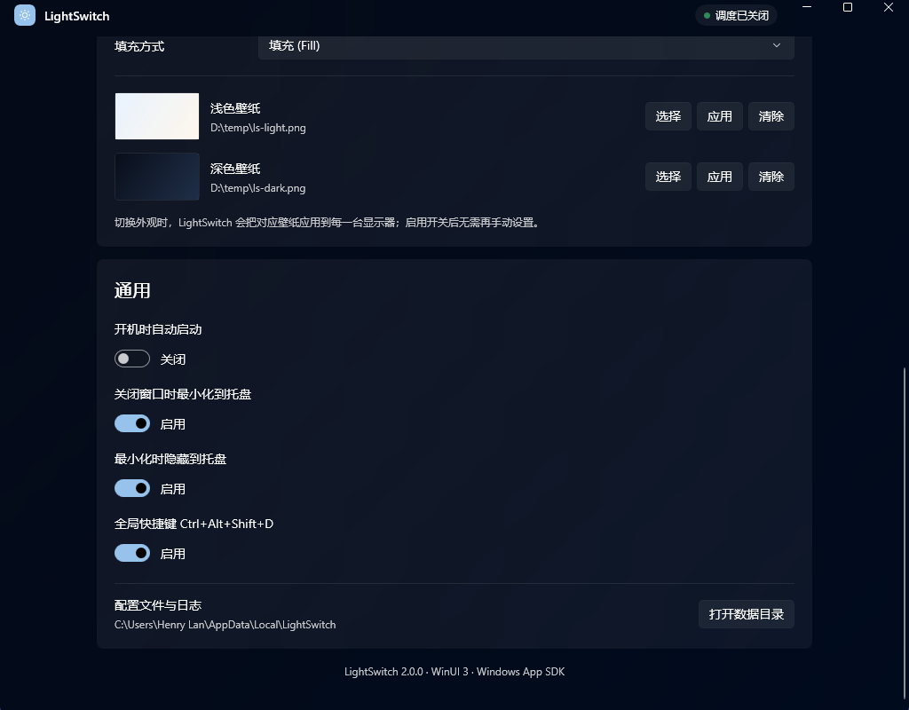

# LightSwitch for Windows

**简体中文** | [English](README.en.md)

> 轻量、零运行时依赖的 Windows 主题与壁纸调度器。

LightSwitch 让 Windows 的**系统主题、应用主题和桌面壁纸**跟随固定时间、日出日落或 Night Light 自动切换。v2 使用 **C# + WinUI 3 + Windows App SDK + Fluent Design** 重写，同时保留托盘常驻、全局热键、单实例、开机自启和命令行控制。

**v2.0.1：默认自包含发布。目标电脑不需要安装 .NET，也不需要 Windows App Runtime。**

> 日常只常驻一个约 92 MB 的托盘进程；只有打开设置时才创建主窗口。



*浅色主题下的主界面（Windows 11，Mica 背景）*

---

## 轻量，是设计约束

LightSwitch 不把“轻量”当形容词，而是当成每项设计决策的约束条件。

| 维度 | 实测 / 设计 |
|------|-------------|
| 托盘常驻 | **91.9 MB** 工作集 · **65.0 MB** 私有内存 · **34** 线程 |
| 空闲 CPU | 30 秒仅 **0.016 秒** CPU 时间（≈ 0%） |
| 进程 | **1 个**：界面、托盘、调度、COM 调用都在同一进程 |
| 服务 / 驱动 / 计划任务 | **0** |
| 管理员权限 | **不需要** |
| 网络请求 / 遥测 | **0** |
| 托盘启动时的可见窗口 | **0**（只有一个隐藏的托盘消息窗口） |
| 默认发布体积 | **170 MB / 461 文件**（自包含，含 .NET 10 与 WinAppSDK） |

### 为什么不是 2 MB？

v1 是 C++ / Win32 + GDI 自绘，内存可以做到 2 MB 以内。v2 换成 WinUI 3 后，XAML 运行时、合成器和 Windows App SDK 本身就带来约 90 MB 的基线——这是技术栈的固定成本，不是业务代码“变重”了。

v2 的目标不是假装这项成本不存在，而是在保留 Fluent 界面的前提下，把**日常常驻**成本压到 WinUI 3 应用的合理下限：

- **托盘启动不创建主窗口**：不加载 XAML 页面、卡片、缩略图和 Mica 合成树；只有主动打开设置时才创建 `MainWindow`。
- **没有高频轮询**：唯一的常规周期任务是 30 秒一次的调度评估；Night Light 通过 `RegNotifyChangeKeyValue` 事件监听，系统主题/时间/显示变化直接触发评估。
- **壁纸预览只解码 160px**：`BitmapImage.DecodePixelWidth = 160`，4K 原图不会完整进入 UI 内存。
- **壁纸引用原文件**：不复制、不转码、不缓存整张图。
- **单进程、无服务**：不安装 Windows 服务、驱动或计划任务，不常驻第二个 helper 进程。
- **无网络与遥测**：应用不发起任何网络请求，配置和日志只在本机。
- **精简依赖**：只引用 `Microsoft.WindowsAppSDK.WinUI` 与 `Microsoft.WindowsAppSDK.Runtime`，不携带完整 metapackage。
- **日志自限**：512 KB 自动轮转，长期运行不会无限增长。

### 170 MB 是磁盘，不是内存

默认自包含发布把 .NET 10 运行时和 Windows App SDK 一起放进目录，所以磁盘上是 **170 MB**；但运行时并不会把整个目录读进内存，托盘常驻仍然是 **约 92 MB**。

如果目标机器已经装了 .NET 10 Desktop Runtime，可以用 `-FrameworkDependent` 生成 **93 MB / 269 文件** 的版本，内存表现相同。

### 诚实的边界

- 打开过主窗口后，WinUI 会保留窗口对象和视觉树；关闭到托盘时进程仍然常驻，内存不会自动回到 92 MB。销毁最后一个窗口会直接退出进程，这是当前 WinUI 桌面应用的限制。
- 因此推荐的日常用法是：开机以 `--startup` 静默驻留托盘，需要改设置时再打开窗口。
- 具体数字会随显卡驱动、DPI、系统版本和壁纸缩略图变化；上表是同一台机器上的 Release 实测值。

---

## 功能特性

### 自动切换

- **固定时间段**：例如 08:00 浅色、20:00 深色。
- **日出日落**：输入经纬度，按当地天文时间切换，并可为日出/日落分别设置偏移分钟数。
- **跟随 Night Light**：Windows 夜间模式开启时深色，关闭时浅色。
- **跨午夜**：支持 22:00–06:00 这类浅色时段。
- **手动覆盖后自动恢复**：手动切换会暂停自动调度，跨越下一个亮/暗边界后自动恢复；也可以点「恢复自动」立即恢复。
- **系统主题与应用主题独立控制**：可只改任务栏/开始菜单，或只改应用窗口。

### 壁纸联动

- **浅色 / 深色壁纸分别设置**：各选一张图片，跟随主题自动应用。
- **应用到所有显示器**：通过 `IDesktopWallpaper` 逐台设置；显示器热插拔后下次切换会重新枚举。
- **六种填充方式**：`Fill`、`Fit`、`Stretch`、`Center`、`Tile`、`Span`。
- **缩略图预览**：只按 160px 解码，避免把 4K 壁纸整张读进内存。
- **立即应用**：每张壁纸旁的「应用」按钮可即时预览，即使壁纸总开关暂时关闭。
- **路径校验**：文件不存在时不调用 COM，界面提示错误并写日志。
- **全链路联动**：自动调度、手动切换、托盘菜单、全局热键、`--apply light|dark` 都会同时切换主题和壁纸。



*壁纸设置：浅色 / 深色各一张，缩略图与立即应用*

### 桌面体验

- **托盘常驻**：关闭或最小化窗口时隐藏到托盘，主窗口按需创建。
- **单实例**：重复启动会把已有窗口唤到前台；`--startup` 的第二次启动不会弹窗。
- **全局热键**：`Ctrl+Alt+Shift+D` 一键切换浅色/深色（同时切换壁纸）。
- **开机自启**：应用内开关，写入当前用户 `Run` 键，以 `--startup` 静默启动。
- **命令行**：`--toggle`、`--apply light|dark`、`--startup` 等。
- **Fluent 界面**：卡片布局、Mica 背景（Windows 11）、自定义标题栏、深浅色自适应。
- **零管理员权限**：只写 HKCU 和当前用户桌面壁纸，不安装服务、不需要提权。

---

## 系统要求

| 项目 | 要求 |
|------|------|
| 操作系统 | Windows 10 1809+ / Windows 11，x64 |
| 运行时（默认发布） | **无**：自带 .NET 10 与 Windows App SDK |
| 图形 | 支持 WinUI 3 的 Windows 桌面环境 |
| 权限 | 普通用户（HKCU + 当前用户壁纸） |
| 磁盘 | 默认自包含约 170 MB；框架依赖约 93 MB |

说明：

- Mica 是 Windows 11 特性；Windows 10 会自动回退为纯色背景，其他功能不受影响。
- 如果更在意磁盘体积，且目标机已安装 .NET 10 Desktop Runtime，可用 `build.ps1 -Publish -FrameworkDependent`。
- 构建机需要 .NET 10 SDK；自包含打包会把构建机上的 .NET 10 运行时复制进发布目录，不需要从 NuGet 下载 runtime pack。

---

## 快速开始

### 从源码构建

前置条件：

- [.NET 10 SDK](https://dotnet.microsoft.com/download/dotnet/10.0)（10.0.4xx 或更高）
- Windows 10/11 x64
- 首次构建能访问 NuGet（之后走本机缓存）

```powershell
git clone https://github.com/realhenrylan/LightSwitch-Windows.git
cd LightSwitch-Windows

# 构建 Release
.\build.ps1

# 构建并运行 30 个测试
.\build.ps1 -Test

# 发布自包含目录（目标机器无需安装 .NET）
.\build.ps1 -Publish

# 可选：更小的框架依赖版本（目标机器需 .NET 10 Desktop Runtime）
.\build.ps1 -Publish -FrameworkDependent
```

也可以直接双击 `build.bat`。默认构建输出：

```text
src\LightSwitch.App\bin\Release\net10.0-windows10.0.19041.0\win-x64\LightSwitch.exe
```

默认发布输出：

```text
artifacts\LightSwitch-win-x64\LightSwitch.exe
```

### 从 v1.x 升级

1. 退出旧的 C++ 版 LightSwitch。
2. 运行 v2 的 `LightSwitch.exe`。
3. 如果 `%LOCALAPPDATA%\LightSwitch\config.json` 不存在，v2 会尝试读取 exe 同目录的旧 `config.json` 并迁移字段。
4. 打开设置，检查壁纸路径、开机自启和热键开关。

旧版源码已归档到 [`legacy/`](legacy/README.md)，仅用于查阅，不再维护。

---

## 使用指南

### 主窗口

| 区域 | 说明 |
|------|------|
| 当前外观 | 当前系统主题、调度模式、下次切换时间；提供「浅色」「深色」「恢复自动」 |
| 调度 | 关闭 / 固定时间段 / 日出日落 / 跟随夜间模式；24 小时制 |
| 日出日落 | 纬度、经度、日出偏移、日落偏移；仅该模式可编辑 |
| 应用外观的对象 | 分别控制 Windows 系统主题和应用主题 |
| 壁纸 | 启用开关、填充方式、浅色/深色壁纸；选择 / 应用 / 清除 |
| 通用 | 开机自启、关闭到托盘、最小化到托盘、全局热键、数据目录 |
| 关于 | 版本与技术栈 |

所有修改在控件失焦或选择后立即保存到 `config.json`，不需要手动点「保存」。

### 壁纸设置

1. 打开「壁纸」卡片，启用右上角开关。
2. 在浅色壁纸一行点「选择」，选一张浅色主题图片。
3. 在深色壁纸一行点「选择」，选一张深色主题图片。
4. 选择填充方式（默认 `Fill`）。
5. 点某一行右侧的「应用」可立即预览，不必等待下一次调度。

推荐使用与显示器比例接近的图片；`Span` 适合多显示器拼接壁纸。

### 系统托盘

右键托盘图标：

| 菜单项 | 功能 |
|--------|------|
| 显示主窗口 | 打开设置 |
| 切换为浅色 / 深色 | 立即切换主题与壁纸 |
| 启用 / 关闭自动调度 | 在「关闭」与「固定时间段」间切换 |
| 退出 | 完全退出进程 |

双击或左键单击托盘图标也会显示主窗口。Windows 11 默认把新图标放进溢出区，可在「任务栏设置 → 其他系统托盘图标」中固定。

### 全局热键

| 热键 | 功能 |
|------|------|
| `Ctrl+Alt+Shift+D` | 切换浅色/深色（同时切换壁纸） |

热键可在设置中关闭。若被占用，日志会记录 `RegisterHotKey failed`；热键失效，但托盘和界面仍可用。

### 关闭与最小化

- 「关闭窗口时最小化到托盘」开启（默认）：点关闭只隐藏窗口，进程继续运行。
- 「最小化时隐藏到托盘」开启（默认）：最小化后从任务栏移除。
- 两项都关闭时，关闭窗口会退出应用。
- 退出请用托盘菜单「退出」，或关闭上述选项后关窗。

---

## 命令行

```powershell
LightSwitch.exe                    # 显示主窗口（带托盘）
LightSwitch.exe --startup          # 静默启动，只驻留托盘（开机自启用）
LightSwitch.exe --hidden           # 同上
LightSwitch.exe --tray             # 同上
LightSwitch.exe --toggle           # 切换一次主题+壁纸后退出
LightSwitch.exe --apply light      # 应用浅色主题+浅色壁纸后退出
LightSwitch.exe --apply dark       # 应用深色主题+深色壁纸后退出
```

- `/toggle`、`/light`、`/dark` 也受支持。
- 一次性命令不会初始化 WinUI；如果已有实例在运行，命令会通过隐藏窗口转发给主实例。
- `--startup` / `--hidden` / `--tray` 在已有实例运行时不会弹出窗口。

---

## 配置文件

路径：

```text
%LOCALAPPDATA%\LightSwitch\config.json
```

修改设置后自动生成；也可以复制 [`config.example.json`](config.example.json) 再改。首次运行且新路径不存在时，会尝试从 exe 同目录的旧 `config.json` 迁移。

```json
{
  "scheduleMode": "FixedHours",
  "changeSystem": true,
  "changeApps": true,
  "lightTime": 480,
  "darkTime": 1200,
  "latitude": "39.9",
  "longitude": "116.4",
  "sunrise_offset": 0,
  "sunset_offset": 0,
  "changeWallpaper": true,
  "lightWallpaper": "C:/Wallpapers/light.jpg",
  "darkWallpaper": "C:/Wallpapers/dark.jpg",
  "wallpaperPosition": "Fill",
  "runAtStartup": false,
  "minimizeToTray": true,
  "closeToTray": true,
  "hotkeyEnabled": true
}
```

| 字段 | 类型 | 默认值 | 说明 |
|------|------|--------|------|
| `scheduleMode` | string | `"Off"` | `Off` / `FixedHours` / `SunsetToSunrise` / `FollowNightLight` |
| `changeSystem` | bool | `true` | 是否控制系统主题 |
| `changeApps` | bool | `true` | 是否控制应用主题 |
| `lightTime` | int | `480` | 浅色开始时间，距午夜分钟数（480 = 08:00） |
| `darkTime` | int | `1200` | 深色开始时间，距午夜分钟数（1200 = 20:00） |
| `latitude` | string | `"39.9"` | 纬度，十进制度数 |
| `longitude` | string | `"116.4"` | 经度，十进制度数 |
| `sunrise_offset` | int | `0` | 日出偏移分钟数，-720～720 |
| `sunset_offset` | int | `0` | 日落偏移分钟数，-720～720 |
| `changeWallpaper` | bool | `false` | 是否随主题切换壁纸 |
| `lightWallpaper` | string | `""` | 浅色壁纸绝对路径 |
| `darkWallpaper` | string | `""` | 深色壁纸绝对路径 |
| `wallpaperPosition` | string | `"Fill"` | `Fill` / `Fit` / `Stretch` / `Center` / `Tile` / `Span` |
| `runAtStartup` | bool | `false` | 是否写入 HKCU 开机启动 |
| `minimizeToTray` | bool | `true` | 最小化时隐藏到托盘 |
| `closeToTray` | bool | `true` | 关闭窗口时隐藏到托盘 |
| `hotkeyEnabled` | bool | `true` | 是否注册 `Ctrl+Alt+Shift+D` |

说明：

- `sunrise_offset` / `sunset_offset` 保留旧版字段名，方便从 v1 迁移；其他字段为 camelCase。
- `lightTime` / `darkTime` 在界面中以 `HH:mm` 显示，文件中存分钟数。
- 外部直接编辑 `config.json` 后，当前版本需要**重启应用**才能读到新值。
- 壁纸路径支持绝对路径；路径不存在会在日志和界面报错，不会清除原壁纸。

---

## 性能

测试环境：Windows 11（10.0.26300），Intel i5-14490F（10 核 / 16 线程），x64，Release 构建。内存为 30 秒采样后的稳定值，CPU 为 30 秒区间内的进程 CPU 时间。

| 场景 | 工作集 | 私有内存 | 线程 | 说明 |
|------|--------|----------|------|------|
| 托盘静默启动（`--startup`，从未打开窗口） | **91.9 MB** | **65.0 MB** | 34 | 30 秒内 CPU 时间 0.016 秒 |
| 主窗口打开 | **148–149 MB** | ~100 MB | 67–68 | 卡片、Mica、缩略图加载后 |
| 框架依赖发布 | — | — | — | 93 MB / 269 文件 |
| 自包含发布 | — | — | — | 170 MB / 461 文件 |

**数字说明**

- 托盘模式是日常推荐形态：开机静默驻留，需要设置时才打开窗口。
- 打开过窗口后关闭到托盘，WinUI 会保留窗口对象，内存通常仍在 146–149 MB；这是当前实现的已知边界，不是“关闭后立刻回到 92 MB”。
- 不同显卡驱动、DPI、系统版本和壁纸缩略图会影响结果；建议以同机 Release 实测为准。

---

## 架构设计

### 项目结构

```text
LightSwitch-Windows/
├── LightSwitch.slnx              # 解决方案（.NET 10 slnx）
├── Directory.Build.props         # 版本、语言版本等公共属性
├── NuGet.config                  # nuget.org 源
├── build.ps1 / build.bat         # 构建、测试、发布
├── tools/
│   └── bundle-dotnet-runtime.ps1 # 把 .NET 运行时装入发布目录
├── config.example.json           # 配置示例
├── README.md / README.en.md      # 中文 / English
├── CHANGELOG.md / PLAN.md
├── LICENSE
├── docs/screenshots/
├── src/
│   ├── LightSwitch.Core/         # 纯逻辑，不依赖 WinUI
│   │   ├── AppSettings.cs        # 配置模型、Clone、Normalize、坐标校验
│   │   ├── SettingsService.cs    # 加载/保存、旧配置迁移、原子写、损坏备份
│   │   ├── AppearanceEngine.cs   # 调度状态机、手动覆盖、状态快照
│   │   ├── ThemeService.cs       # HKCU Personalize 注册表 + 系统广播
│   │   ├── WallpaperService.cs   # IDesktopWallpaper COM + SPI 回退
│   │   ├── NightLightService.cs  # 读取 CloudStore Night Light 状态
│   │   ├── NightLightWatcher.cs  # RegNotifyChangeKeyValue 后台监听
│   │   ├── ScheduleMath.cs       # 跨午夜判断、下一个边界
│   │   ├── SunCalculator.cs      # 日出日落天文公式
│   │   ├── StartupService.cs     # HKCU Run 开机自启
│   │   └── AppPaths / Log / Models / EngineState / Interfaces
│   └── LightSwitch.App/          # WinUI 3 应用
│       ├── Program.cs            # 自定义 Main、单实例、CLI 分流
│       ├── App.xaml(.cs)         # XAML 资源与启动入口
│       ├── AppHost.cs            # 生命周期、托盘、定时器、保存设置
│       ├── MainWindow.xaml(.cs)  # Fluent 设置界面
│       ├── CommandLine.cs / CliRunner.cs
│       ├── Tray/TrayHost.cs      # 隐藏 Win32 窗口 + Shell_NotifyIcon
│       ├── Tray/IconFactory.cs
│       ├── Interop/NativeMethods.cs
│       └── Assets/app.ico
├── tests/
│   └── LightSwitch.Tests/        # 零依赖控制台测试 harness（30 个用例）
└── legacy/                       # v1.1.0 C++ / Win32 + GDI 归档
```

### 运行流程

```text
时间触发（30s）/ 系统事件 / Night Light 变更 / 手动点击 / 托盘 / 热键 / CLI
                              │
                              ▼
                    AppearanceEngine.Evaluate
                              │
              ┌───────────────┼────────────────┐
              ▼               ▼                ▼
        ThemeService     WallpaperService  状态快照 StateChanged
        （注册表+广播）   （COM 逐显示器）        │
                                              ▼
                                      MainWindow / TrayHost
```

- **主题**：写 `HKCU\Software\Microsoft\Windows\CurrentVersion\Themes\Personalize` 的 `SystemUsesLightTheme`、`AppsUseLightTheme`，然后广播 `WM_SETTINGCHANGE("ImmersiveColorSet")`、`WM_THEMECHANGED`、`WM_DWMCOLORIZATIONCOLORCHANGED`。
- **壁纸**：`CoCreateInstance(CLSID_DesktopWallpaper)` → `IDesktopWallpaper.SetPosition` + 逐显示器 `SetWallpaper`；COM 不可用时回退 `SystemParametersInfo(SPI_SETDESKWALLPAPER)` 并写 `WallpaperStyle`。
- **Night Light**：读取 `HKCU\...\CloudStore\...\bluelightreductionstate` 的二进制 `Data`，长度 ≥ 25 且 `data[23] == 0x10 && data[24] == 0x00` 视为开启；后台线程用 `RegNotifyChangeKeyValue` 监听。
- **手动覆盖**：固定时间 / 日出日落模式下，手动切换后记录 `manualUntil = 下一个亮暗边界`；到期自动恢复。`Off` 和 `FollowNightLight` 不记录覆盖。
- **单实例**：`Local\LightSwitch.SingleInstance` 互斥体；已存在时通过 `FindWindowW("LightSwitch.TrayHost")` + `PostMessage` 发 `WM_APP` 消息。
- **托盘**：隐藏的顶层窗口接收 `Shell_NotifyIcon` 回调，右键用原生 `TrackPopupMenuEx`，热键用 `RegisterHotKey`（`MOD_NOREPEAT`）。

### 调度模式语义

| 模式 | 目标 | 说明 |
|------|------|------|
| `Off` | 不写主题 | 仍会把壁纸同步到当前系统主题（若壁纸启用） |
| `FixedHours` | 按 `lightTime` / `darkTime` | 支持跨午夜；手动覆盖到下一个边界 |
| `SunsetToSunrise` | 按经纬度计算的日出/日落 | 每天重新计算；极昼/极夜回退 06:00 / 18:00 |
| `FollowNightLight` | Night Light 开 = 深色，关 = 浅色 | 监听注册表变化，不记录手动覆盖 |

---

## 壁纸实现

v2 的壁纸行为参考了 [AutoDarkMode / Windows-Auto-Night-Mode](https://github.com/AutoDarkMode/Windows-Auto-Night-Mode) 的公开设计，但只实现了一个**简化子集**：

| 能力 | LightSwitch v2 | AutoDarkMode |
|------|----------------|--------------|
| 浅色 / 深色各一张 | ✅ | ✅ |
| 应用到所有显示器 | ✅ 循环 `SetWallpaper` | ✅ 支持全局与逐显示器 |
| 按显示器单独设置 | ❌ | ✅ |
| 填充方式 | ✅ 六种 | ✅ |
| 纯色 / Spotlight | ❌ | ✅ |
| 缩略图预览 | ✅ 160px 解码 | ✅ |
| 与调度 / 手动切换集成 | ✅ | ✅ |

实现要点：

- 使用 `IDesktopWallpaper`（IID `{B92B56A9-8B55-4E14-9A89-0199BBB6F93B}`，CLSID `{C2CF3110-460E-4fc1-B9D0-8A1C0C9CC4BD}`）。
- 每个显示器调用一次 `SetWallpaper(monitorId, path)`；`SetPosition` 是全局设置。
- 不能通过 `HKCU\Control Panel\Desktop\WallPaper` 判断当前壁纸（Windows 会把它改成 `TranscodedWallpaper`）；状态比较使用 `GetWallpaper(monitorId)`。
- 壁纸是原路径引用，不复制文件；移动/删除图片后下次切换会失败并写日志。

---

## 已知限制

- **壁纸是全局一对**：不能给不同显示器配不同图片。
- **不支持纯色 / Windows Spotlight / 壁纸轮播历史**。
- **外部修改 `config.json` 不会热重载**：请重启应用，或在设置窗口中重新修改一次设置。
- **Mica 仅 Windows 11**：Windows 10 使用纯色背景。
- **内存基线**：WinUI 3 托盘静默约 92 MB；打开过主窗口后约 146–149 MB，隐藏窗口不会释放视觉树。
- **热键固定为 `Ctrl+Alt+Shift+D`**，暂不支持自定义组合键。
- **自包含发布用构建机的 .NET 运行时手工装配**：构建机需有对应版本的 .NET 10 SDK；发布目录包含该运行时副本。
- **界面目前为简体中文**，尚未做多语言资源；English README 是文档翻译，不改变界面语言。
- **单用户会话**：互斥体在 `Local\`，不同登录会话可以各自运行。

---

## 故障排查

### 日志

```text
%LOCALAPPDATA%\LightSwitch\LightSwitch.log
```

超过 512 KB 会滚动为 `LightSwitch.log.old`。日志记录启动参数、每次评估、主题/壁纸应用结果、托盘/热键注册失败、配置保存错误等。

### 托盘图标找不到

Windows 11 会把新图标收进溢出区。打开「设置 → 个性化 → 任务栏 → 其他系统托盘图标」，把 LightSwitch 设为显示。若仍找不到，检查日志中是否有 `Shell_NotifyIcon(NIM_ADD) failed`。

### 壁纸不切换

1. 确认「壁纸」开关已启用。
2. 确认浅色/深色壁纸都已选择，且文件仍然存在。
3. 检查调度模式：`Off` 不会主动改主题，但会按当前主题同步壁纸；`FollowNightLight` 需要 Night Light 状态变化。
4. 点对应壁纸行的「应用」强制应用一次，观察日志中的 `Wallpaper applied ...` 或错误信息。
5. 如果日志提示已设置但桌面没变，可能是组策略或第三方壁纸软件接管了桌面。

### 开机自启没生效

- 设置中打开「开机时自动启动」会写 `HKCU\Software\Microsoft\Windows\CurrentVersion\Run`，值为 `"<当前 exe 路径>" --startup`。
- 移动过 exe 后，关闭再打开一次该开关，刷新路径。
- 某些安全软件会拦截 Run 键写入；查看日志中的 `startup` 错误。

### 热键无效

日志出现 `RegisterHotKey failed` 说明组合键被占用；先在设置中关闭热键，退出占用程序后再打开。

### 重置设置

删除 `%LOCALAPPDATA%\LightSwitch\config.json`，重启应用即回到默认值（默认调度关闭、壁纸关闭）。也可以在设置中「打开数据目录」后手动删除。

---

## 开发

### 构建与测试

```powershell
dotnet build LightSwitch.slnx -c Release
.\build.ps1 -Test
```

测试使用零依赖控制台 harness（`tests/LightSwitch.Tests`），不依赖 xUnit 包，覆盖：

- `ScheduleMath`：同日/跨午夜边界、下一个边界、精确边界顺延；
- `SunCalculator`：北京、赤道、极昼、非法坐标；
- `SettingsService`：旧 snake_case 配置、往返序列化、Normalize；
- `AppearanceEngine`：固定时间、手动覆盖到下一个边界、FollowNightLight、亮/暗壁纸、Off 模式、日落偏移。

当前结果：**30/30 通过**。

### 发布

```powershell
# 默认：自包含，目标机器不需要 .NET 运行时
.\build.ps1 -Publish

# 可选：框架依赖，体积更小，目标机器需 .NET 10 Desktop Runtime
.\build.ps1 -Publish -FrameworkDependent
```

输出在 `artifacts\LightSwitch-win-x64\`（可用 `-OutputDirectory` 覆盖）。

自包含发布先由 `dotnet publish` 生成框架依赖目录，再由 `tools/bundle-dotnet-runtime.ps1` 完成：

1. 复制构建机上 `shared\Microsoft.NETCore.App\<version>` 的全部文件；
2. 复制对应版本的 `hostfxr.dll`；
3. 把 `runtimeconfig.json` 的 `framework` 改成 `includedFrameworks`，并将运行时资产合并进 `deps.json`。

这样不需要从 NuGet 下载 runtime pack。代价是发布目录约 170 MB / 461 文件；升级 .NET 运行时版本时重新执行即可。

### 代码约定

- `LightSwitch.Core` 不引用 WinUI；注册表、COM、P/Invoke 集中在 Core 的 Service 中，便于测试。
- `AppSettings` 交给引擎前视为不可变；UI 编辑 `Clone()` 后整体回传。
- 新增调度逻辑优先放进 `ScheduleMath` / `AppearanceEngine` 并补测试。
- P/Invoke 常量集中在 `Interop/NativeMethods.cs`，不要在业务代码里散落魔法数字。

---

## 许可

本项目使用 [MIT License](LICENSE)。

- v1 基于 [Microsoft PowerToys](https://github.com/microsoft/PowerToys) 的 LightSwitch 模块（MIT）构建；v2 保留了其主题注册表、Night Light 检测和日出日落算法的思路。
- 壁纸功能的设计参考了 [AutoDarkMode / Windows-Auto-Night-Mode](https://github.com/AutoDarkMode/Windows-Auto-Night-Mode)（MIT）。
- Windows、WinUI、Windows App SDK 是 Microsoft 的商标/产品；本项目与 Microsoft 无隶属关系。
